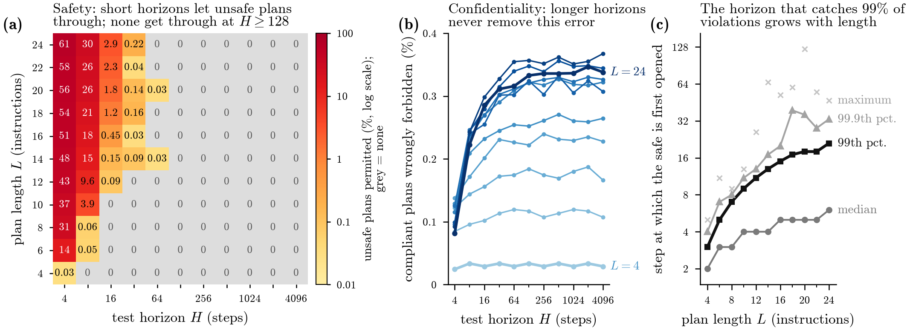

# Impossibility Theorem: reproducibility materials

Companion code, synthetic data, tables and figures for the version 14 manuscript:

**No finite rulebook can certify every safe program: an impossibility theorem for gatekeeping AI agents**  
**Tomás Pérez-Acle**, Universidad San Sebastián, Chile.

Repository: <https://github.com/Tomasao/Impossibility-Theorem>

## Research question

In a fixed programming environment, can a gatekeeper classify every program as permitted or forbidden using finite, mechanically checkable evidence? The manuscript examines safety (absence of a specified forbidden event), confidentiality (equality of complete public-output sequences for two secret inputs), and response (an eventual answer for every input). The environment and the normative interpretation remain fixed.

The simulations illustrate constructions and measure error rates in specified synthetic program populations. They do not prove the impossibility results or estimate the behaviour of deployed AI agents.



*Archived Figure 4. Rates are specific to the declared sampler and resolved labels; see the result-to-code map and limitations below.*

## Status of this archive

The supplied scientific scripts and data are preserved. Added tools provide a complete execution sequence, derive the previously ungenerated percentile table, export numerical tables, and record comparisons. **Numerical reproduction and scientific validity are separate checks.** Read [known limitations](docs/KNOWN_LIMITATIONS.md) and the [validation record](docs/VALIDATION.md) before interpreting the results, particularly Simulations 3 and 5. This package is a documented research snapshot; it is not an assertion that every manuscript claim has been validated.

## Start here

Use Python 3.9 or later. Simulation and table-generation code uses the standard library.

```bash
python3 reproduce.py --suite archive
```

This checks archive integrity and reconstructs numerical tables and editable TeX figure sources from the archived data, without rerunning the populations. Outputs are written under `build/reproduction/`; archived inputs are preserved.

To rerun every experiment, including the 2.2-million-program population:

```bash
python3 reproduce.py --suite full
```

For all figure PDFs, install the plotting dependencies and a TeX distribution with pdfLaTeX, TikZ and PGFPlots, then run:

```bash
python3 -m venv .venv
source .venv/bin/activate
python -m pip install -r requirements-figures.txt
python reproduce.py --suite full --plots --tex
```

On Windows, activate the environment with `.venv\Scripts\Activate.ps1` and use `python`. See the [complete reproduction instructions](REPRODUCIBILITY.md), including expected differences and resource requirements.

## Contents

| Path | Purpose |
| --- | --- |
| `reproducibility/` | Original simulation/verification scripts and archived CSV/JSON data |
| `figures/` | Sources and archived outputs of manuscript Figures 1–4 |
| `supplementary/` | Original Supplementary Document S1 and its TeX source |
| `scripts/` | Added percentile, table-export and limitation-check tools |
| `tables/reference/` | Original manuscript table fragments, including conceptual tables |
| `tables/generated/` | CSV, Markdown and TeX exports of numerical tables |
| `docs/RESULTS_MAP.md` | Manuscript result → script → data → figure/table mapping |
| `docs/DATA_DICTIONARY.md` | Data provenance, populations, units, fields and denominators |
| `docs/VALIDATION.md` | Checks performed and their limitations |
| `docs/KNOWN_LIMITATIONS.md` | Confirmed implementation and interpretation issues |
| `CITATION.cff` | Citation metadata for this software/data snapshot |
| `MANIFEST_SHA256.json` | Integrity hashes for the delivered package |

Data are synthetic. CSV files contain observations or aggregated counts; the 2.2 million sampled program codes are regenerated from the specified sampling procedure and seeds rather than stored as individual code files. No external dataset or API is required.

## Citation, licence and reuse

Use the repository citation metadata and record the exact commit or release used. The manuscript is not represented here as an accepted or published journal article. A DOI can be added after an archival deposit.

Retain and inspect the destination repository's existing `LICENSE` file when uploading this package. The supplied ZIP contains no licence, and this preparation does not grant a new licence or replace an existing one. See [licensing and release notes](docs/LICENSING_AND_RELEASE.md).

## Questions and contributions

Report reproducibility problems through the repository's Issues page, including the command, Python version and `reproduction_report.json`, with local paths or unrelated personal information removed. Changes to scientific semantics or reference data should be reviewed separately and released under a new version.
